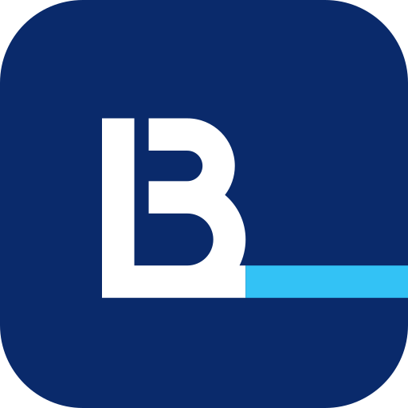

# Concept 01 — Horizon

> Monogramme B + L : une seule hampe, et le pied du L qui file en ligne d'horizon.

  
  &nbsp;&nbsp;
  

## Intention

1. Le B et le L partagent une seule hampe : la colonne vertébrale de l'entreprise, lisible comme un monogramme « BL ».
2. Le pied du L dépasse les panses du B et devient la ligne d'horizon, la route vers laquelle tout avance.
3. La coupe en pochoir entre hampe et panses reprend le marquage des conteneurs : un signe industriel, fait pour être peint.

## Fichiers

| Fichier | Usage |
|---|---|
| `logo-horizontal.svg` | Version principale : en-têtes, documents, signatures |
| `logo-vertical.svg` | Formats carrés ou hauts : flancs de camion, kakémonos, réseaux sociaux |
| `icon.svg` | Symbole seul sur tuile carrée : favicon, avatar, application |
| `logo-mono-black.svg` | Une couleur : tampons, fax, gravure, sérigraphie, documents douaniers |
| `logo-mono-white.svg` | Une couleur en réserve : sur photo, sur le bleu, sur la tôle d'un conteneur |
| `logo-horizontal-reverse.svg`, `logo-vertical-reverse.svg` | Couleur sur fond sombre (blanc + accent éclairci) |

Tous les fichiers sont des aplats vectoriels purs : aucun texte vivant, aucun filtre, aucune image, aucune
dépendance externe. Les superpositions de couleur sont résolues, donc un fichier passe tel quel en découpe vinyle
ou en sérigraphie.

## Palette

| Rôle | Nom | Hex | RVB | Contraste |
|---|---|---|---|---|
| Dominante | Bleu Nuit | `#0A2A6B` | 10, 42, 107 | 13,5:1 sur blanc |
| Accent | Cyan Horizon | `#139FDB` | 19, 159, 219 | 3,0:1 sur blanc · 4,5:1 sur la dominante |
| Accent sur fond sombre | Cyan Horizon clair | `#33C2F5` | 51, 194, 245 | 8,6:1 sur Nuit |
| Fond sombre | Nuit | `#061638` | 6, 22, 56 | 17,8:1 avec le blanc |
| Fond clair | Brume | `#F3F6FB` | 243, 246, 251 | papier, écrans, documents |

**Pourquoi cet accent ?** Le cyan est la lumière de l'horizon marin. De la même famille que le bleu, il garde une identité sobre et sérieuse, mais il est assez lumineux pour ressortir sur fond sombre, sur la tôle d'un conteneur ou sur un écran. Il ne sert qu'à la ligne : c'est elle qu'on retient.

Le logo n'utilise que deux couleurs, en aplat : il s'imprime en deux tons directs, et en un seul avec les versions
mono.

## Typographie

**Manrope** (ExtraBold 800 pour BLUE LINE, Medium 500 pour SHIPPING), via Google Fonts, sous licence SIL Open Font License 1.1 (usage commercial
libre, y compris dans l'ERP et sur le web).

Manrope est une grotesque géométrique aux formes ouvertes et aux terminaisons nettes. En ExtraBold, elle a la densité du monogramme ; en Medium espacé, SHIPPING reste lisible en petit. Ses chiffres sont clairs pour les références de dossiers et de conteneurs.

Dans les fichiers SVG, le texte est déjà converti en tracés : la police n'est nécessaire que pour composer
d'autres textes (site, documents, ERP).

## Zone d'exclusion

Unité **x = la moitié de la hauteur du symbole** (environ la hauteur de la panse haute du B). Laisser 1 x de chaque côté du logo. Aucun texte, aucun bord de support ni aucun autre logo ne doit entrer dans cette zone.
Pour l'icône, la tuile elle-même fait office de zone de protection : laisser au moins 1/8 de sa largeur autour.

## Taille minimale

| Version | Écran | Impression |
|---|---|---|
| Horizontale | 130 px de large | 40 mm de large |
| Verticale | 80 px de large | 25 mm de large |
| Icône | 16 px (favicon), testée nette à 24 px | 6 mm |

Ces minimums garantissent une capitale de SHIPPING d'au moins 5 px à l'écran et 1,5 mm à l'impression. En dessous,
utiliser l'icône seule.

Pas de taille maximale : les tracés vectoriels restent nets sur un conteneur de 40 pieds (12 m) ou une remorque.

## À éviter

- Raccourcir la ligne d'horizon au ras du B : c'est elle qui porte le nom « Line ».
- Refermer la coupe pochoir entre la hampe et les panses.
- Déformer, incliner, ajouter une ombre, un contour, un dégradé ou un effet.
- Recomposer le nom dans une autre police ou changer la position du symbole.
