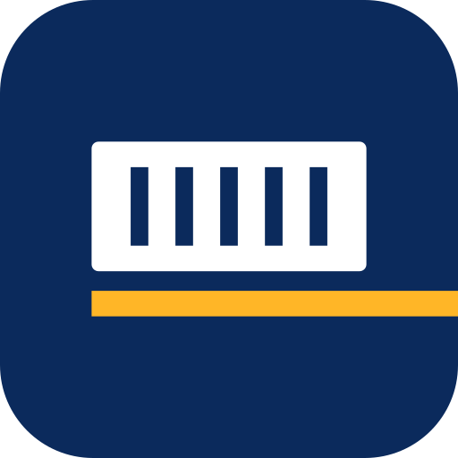

# Concept 02 — Ondulation

> Un conteneur réduit à un bloc et à ses lignes de tôle ondulée, posé sur la route.

  
  &nbsp;&nbsp;
  

## Intention

1. Le conteneur est l'unité de base du métier : ici, un bloc et sept fentes, la tôle ondulée dessinée en lignes négatives.
2. Il est posé sur une ligne jaune qui le dépasse vers l'avant : la route maritime, le transit, la livraison.
3. Le sens est immédiat pour un importateur ou un transitaire, même à 24 px, sans tomber dans l'illustration.

## Fichiers

| Fichier | Usage |
|---|---|
| `logo-horizontal.svg` | Version principale : en-têtes, documents, signatures |
| `logo-vertical.svg` | Formats carrés ou hauts : flancs de camion, kakémonos, réseaux sociaux |
| `icon.svg` | Symbole seul sur tuile carrée : favicon, avatar, application |
| `logo-mono-black.svg` | Une couleur : tampons, fax, gravure, sérigraphie, documents douaniers |
| `logo-mono-white.svg` | Une couleur en réserve : sur photo, sur le bleu, sur la tôle d'un conteneur |
| `logo-horizontal-reverse.svg`, `logo-vertical-reverse.svg` | Couleur sur fond sombre (blanc + accent éclairci) |

Tous les fichiers sont des aplats vectoriels purs : aucun texte vivant, aucun filtre, aucune image, aucune
dépendance externe. Les superpositions de couleur sont résolues, donc un fichier passe tel quel en découpe vinyle
ou en sérigraphie.

## Palette

| Rôle | Nom | Hex | RVB | Contraste |
|---|---|---|---|---|
| Dominante | Bleu Marine | `#0B2A5C` | 11, 42, 92 | 14,0:1 sur blanc |
| Accent | Jaune Conteneur | `#F2A007` | 242, 160, 7 | 2,1:1 sur blanc · 6,5:1 sur la dominante |
| Accent sur fond sombre | Jaune Conteneur clair | `#FFB627` | 255, 182, 39 | 9,8:1 sur Nuit Portuaire |
| Fond sombre | Nuit Portuaire | `#081A3A` | 8, 26, 58 | 17,2:1 avec le blanc |
| Fond clair | Quai | `#F5F3EE` | 245, 243, 238 | papier, écrans, documents |

**Pourquoi cet accent ?** Le jaune ambré est la couleur de la signalisation portuaire, des portiques et de nombreux conteneurs. Opposé au bleu marine sur le cercle chromatique, il donne le contraste maximal entre les deux teintes et reste visible de loin sur un camion. Sur fond blanc, il ne porte jamais de texte, seulement la ligne.

Le logo n'utilise que deux couleurs, en aplat : il s'imprime en deux tons directs, et en un seul avec les versions
mono.

## Typographie

**Space Grotesk** (Bold 700 pour BLUE LINE, Medium 500 pour SHIPPING), via Google Fonts, sous licence SIL Open Font License 1.1 (usage commercial
libre, y compris dans l'ERP et sur le web).

Space Grotesk est une grotesque au caractère technique, héritée d'une monospace. Elle évoque la logistique et l'ingénierie sans froideur, et ses chiffres sont très lisibles. C'est un atout pour l'ERP : numéros de BL, de conteneurs (ISO 6346), de DAU.

Dans les fichiers SVG, le texte est déjà converti en tracés : la police n'est nécessaire que pour composer
d'autres textes (site, documents, ERP).

## Zone d'exclusion

Unité **x = la hauteur du conteneur divisée par deux**. Laisser 1 x de chaque côté du logo. Aucun texte, aucun bord de support ni aucun autre logo ne doit entrer dans cette zone.
Pour l'icône, la tuile elle-même fait office de zone de protection : laisser au moins 1/8 de sa largeur autour.

## Taille minimale

| Version | Écran | Impression |
|---|---|---|
| Horizontale | 160 px de large | 50 mm de large |
| Verticale | 80 px de large | 25 mm de large |
| Icône | 16 px (favicon), testée nette à 24 px | 6 mm |

Ces minimums garantissent une capitale de SHIPPING d'au moins 5 px à l'écran et 1,5 mm à l'impression. En dessous,
utiliser l'icône seule.

Pas de taille maximale : les tracés vectoriels restent nets sur un conteneur de 40 pieds (12 m) ou une remorque.

## À éviter

- Ajouter des fentes ou du détail au conteneur : sept lignes suffisent, et cinq dans l'icône.
- Détacher la route du conteneur ou la placer au-dessus.
- Déformer, incliner, ajouter une ombre, un contour, un dégradé ou un effet.
- Recomposer le nom dans une autre police ou changer la position du symbole.
