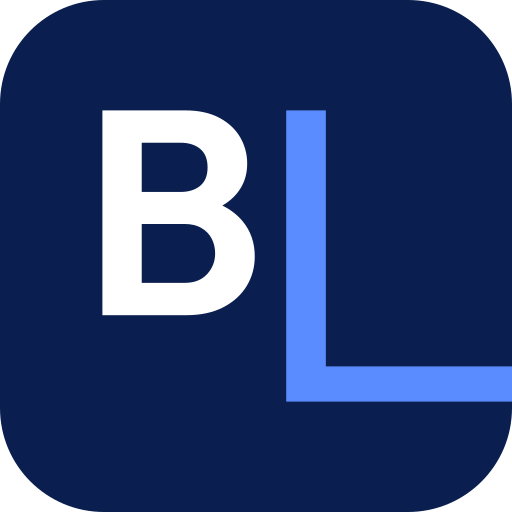

# Concept 03 — La Ligne

> Logotype pur : le L de LINE descend sous la ligne de base et souligne le mot.

  
  &nbsp;&nbsp;
  

## Intention

1. Pas de symbole ajouté : la marque, c'est le nom. Le L de LINE descend sous la ligne de base et file sous « INE ».
2. La lettre devient la ligne, et la ligne souligne la promesse. SHIPPING vient se ranger à sa hauteur, sous BLUE.
3. Le monogramme BL de l'icône reprend le même L : un seul geste typographique, reconnaissable partout.

## Fichiers

| Fichier | Usage |
|---|---|
| `logo-horizontal.svg` | Version principale : en-têtes, documents, signatures |
| `logo-vertical.svg` | Formats carrés ou hauts : flancs de camion, kakémonos, réseaux sociaux |
| `icon.svg` | Symbole seul sur tuile carrée : favicon, avatar, application |
| `logo-mono-black.svg` | Une couleur : tampons, fax, gravure, sérigraphie, documents douaniers |
| `logo-mono-white.svg` | Une couleur en réserve : sur photo, sur le bleu, sur la tôle d'un conteneur |
| `logo-horizontal-reverse.svg`, `logo-vertical-reverse.svg` | Couleur sur fond sombre (blanc + accent éclairci) |

Tous les fichiers sont des aplats vectoriels purs : aucun texte vivant, aucun filtre, aucune image, aucune
dépendance externe. Les superpositions de couleur sont résolues, donc un fichier passe tel quel en découpe vinyle
ou en sérigraphie.

## Palette

| Rôle | Nom | Hex | RVB | Contraste |
|---|---|---|---|---|
| Dominante | Bleu Encre | `#0A1F4F` | 10, 31, 79 | 15,9:1 sur blanc |
| Accent | Bleu Électrique | `#2563EB` | 37, 99, 235 | 5,2:1 sur blanc · 3,1:1 sur la dominante |
| Accent sur fond sombre | Bleu Électrique clair | `#5B8CFF` | 91, 140, 255 | 6,1:1 sur Nuit |
| Fond sombre | Nuit | `#050E26` | 5, 14, 38 | 19,1:1 avec le blanc |
| Fond clair | Papier | `#F4F6FA` | 244, 246, 250 | papier, écrans, documents |

**Pourquoi cet accent ?** C'est « Blue Line » au sens propre : le nom en bleu encre, la ligne en bleu électrique. On obtient une identité presque monochrome, très B2B, où l'accent ne crie pas : il signale. Le bleu électrique est la couleur de l'écran et du signal, cohérente avec un ERP et des outils numériques.

Le logo n'utilise que deux couleurs, en aplat : il s'imprime en deux tons directs, et en un seul avec les versions
mono.

## Typographie

**Outfit** (SemiBold 600 pour BLUE LINE, Regular 400 pour SHIPPING), via Google Fonts, sous licence SIL Open Font License 1.1 (usage commercial
libre, y compris dans l'ERP et sur le web).

Outfit est une géométrique pure, aux capitales rondes et régulières, très lisibles à distance. Sa chasse moyenne garde le logotype compact malgré ses neuf lettres. Le L est redessiné à partir des épaisseurs de la police (fût et barre) pour rester dans la famille.

Dans les fichiers SVG, le texte est déjà converti en tracés : la police n'est nécessaire que pour composer
d'autres textes (site, documents, ERP).

## Zone d'exclusion

Unité **x = la hauteur des capitales de BLUE LINE**. Laisser 0,5 x au-dessus, à gauche et à droite, et 0,5 x sous la ligne. Aucun texte, aucun bord de support ni aucun autre logo ne doit entrer dans cette zone.
Pour l'icône, la tuile elle-même fait office de zone de protection : laisser au moins 1/8 de sa largeur autour.

## Taille minimale

| Version | Écran | Impression |
|---|---|---|
| Horizontale | 130 px de large | 40 mm de large |
| Verticale | 130 px de large | 40 mm de large |
| Icône | 16 px (favicon), testée nette à 24 px | 6 mm |

Ces minimums garantissent une capitale de SHIPPING d'au moins 5 px à l'écran et 1,5 mm à l'impression. En dessous,
utiliser l'icône seule.

Pas de taille maximale : les tracés vectoriels restent nets sur un conteneur de 40 pieds (12 m) ou une remorque.

## À éviter

- Remettre un L standard ou détacher la ligne du L.
- Prolonger la ligne au-delà du E final ou la colorer autrement que le L.
- Déformer, incliner, ajouter une ombre, un contour, un dégradé ou un effet.
- Recomposer le nom dans une autre police ou changer la position du symbole.
