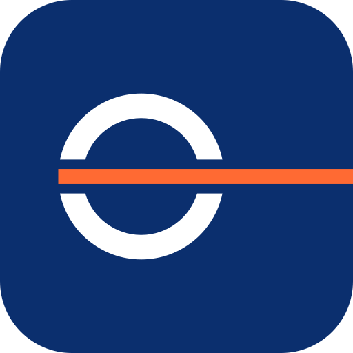

# Concept 05 — Ligne de charge

> Le disque de Plimsoll, la marque de sécurité de chaque navire marchand, traversé par la ligne.

  
  &nbsp;&nbsp;
  

## Intention

1. Le disque de Plimsoll est peint sur la coque de chaque navire marchand : c'est la ligne de charge à ne jamais dépasser.
2. Ici, l'anneau est coupé par la ligne, qui en sort vers l'avant. Le signe dit sécurité, conformité, précision : le cœur du transit et du dédouanement.
3. C'est un signe de métier, que reconnaissent les professionnels du maritime, et sans aucun cliché (ni ancre, ni vague).

## Fichiers

| Fichier | Usage |
|---|---|
| `logo-horizontal.svg` | Version principale : en-têtes, documents, signatures |
| `logo-vertical.svg` | Formats carrés ou hauts : flancs de camion, kakémonos, réseaux sociaux |
| `icon.svg` | Symbole seul sur tuile carrée : favicon, avatar, application |
| `logo-mono-black.svg` | Une couleur : tampons, fax, gravure, sérigraphie, documents douaniers |
| `logo-mono-white.svg` | Une couleur en réserve : sur photo, sur le bleu, sur la tôle d'un conteneur |
| `logo-horizontal-reverse.svg`, `logo-vertical-reverse.svg` | Couleur sur fond sombre (blanc + accent éclairci) |

Tous les fichiers sont des aplats vectoriels purs : aucun texte vivant, aucun filtre, aucune image, aucune
dépendance externe. Les superpositions de couleur sont résolues, donc un fichier passe tel quel en découpe vinyle
ou en sérigraphie.

## Palette

| Rôle | Nom | Hex | RVB | Contraste |
|---|---|---|---|---|
| Dominante | Bleu Coque | `#0B2F6E` | 11, 47, 110 | 12,8:1 sur blanc |
| Accent | Orange International | `#FF5A1F` | 255, 90, 31 | 3,1:1 sur blanc · 4,1:1 sur la dominante |
| Accent sur fond sombre | Orange International clair | `#FF6A33` | 255, 106, 51 | 6,0:1 sur Nuit |
| Fond sombre | Nuit | `#071A3E` | 7, 26, 62 | 17,1:1 avec le blanc |
| Fond clair | Écume | `#F3F5F9` | 243, 245, 249 | papier, écrans, documents |

**Pourquoi cet accent ?** L'orange international est la couleur de sécurité de la marine : canots, engins de sauvetage, marquages. Il porte la ligne de charge, donc le message de sécurité. Complémentaire du bleu coque, il offre le contraste le plus fort de la palette et reste lisible en grand format comme en favicon.

Le logo n'utilise que deux couleurs, en aplat : il s'imprime en deux tons directs, et en un seul avec les versions
mono.

## Typographie

**Readex Pro** (SemiBold 600 pour BLUE LINE, Regular 400 pour SHIPPING), via Google Fonts, sous licence SIL Open Font License 1.1 (usage commercial
libre, y compris dans l'ERP et sur le web).

Readex Pro est une géométrique issue de Lexend, une famille conçue pour la lisibilité. Elle couvre **le latin et l'arabe dans la même famille**. Factures, documents douaniers, signalétique et interfaces de l'ERP peuvent donc être bilingues français-arabe avec une seule voix typographique.

Dans les fichiers SVG, le texte est déjà converti en tracés : la police n'est nécessaire que pour composer
d'autres textes (site, documents, ERP).

## Zone d'exclusion

Unité **x = le rayon de l'anneau**. Laisser 1 x de chaque côté du logo. Aucun texte, aucun bord de support ni aucun autre logo ne doit entrer dans cette zone.
Pour l'icône, la tuile elle-même fait office de zone de protection : laisser au moins 1/8 de sa largeur autour.

## Taille minimale

| Version | Écran | Impression |
|---|---|---|
| Horizontale | 150 px de large | 45 mm de large |
| Verticale | 90 px de large | 30 mm de large |
| Icône | 16 px (favicon), testée nette à 24 px | 6 mm |

Ces minimums garantissent une capitale de SHIPPING d'au moins 5 px à l'écran et 1,5 mm à l'impression. En dessous,
utiliser l'icône seule.

Pas de taille maximale : les tracés vectoriels restent nets sur un conteneur de 40 pieds (12 m) ou une remorque.

## À éviter

- Prolonger la ligne des deux côtés de l'anneau : on retomberait sur une cocarde de transport urbain.
- Refermer l'anneau derrière la ligne ou épaissir la ligne au-delà du trait de l'anneau.
- Déformer, incliner, ajouter une ombre, un contour, un dégradé ou un effet.
- Recomposer le nom dans une autre police ou changer la position du symbole.
