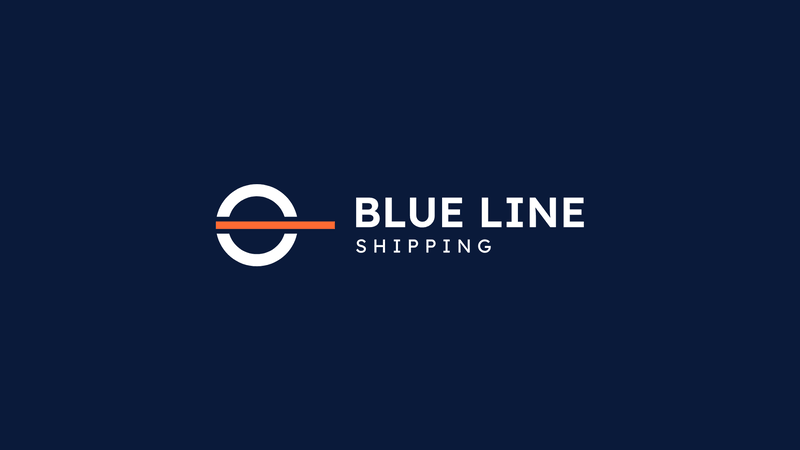

# Motion : révélation du logo (concept 05, Ligne de charge)



En 8 secondes, l'animation raconte l'histoire du symbole. Sur la coque d'un cargo, la marque de Plimsoll indique la
ligne de charge que le navire ne doit jamais dépasser. Elle devient le logo Blue Line Shipping. La ligne orange ne
change jamais : c'est le fil conducteur, le soleil à l'horizon.

Il existe deux versions et une fin alternative :

| Version | Fond | Coque, anneau, texte | Ligne | Dernière image |
|---|---|---|---|---|
| **Claire** (par défaut) | Écume `#F3F5F9`, constant | Bleu Coque `#0B2F6E` | `#FF5A1F` | `logo-horizontal.svg` sur Écume, au pixel près |
| **Sombre** (`?theme=dark`) | Bleu Coque `#0B2F6E` → Marine nuit `#0A1A3A` | Blanc | `#FF6A33` | `logo-horizontal-reverse.svg` sur Marine nuit, au pixel près |
| **Fin conteneur** (`?theme=dark&ending=container`) | version sombre, puis la caméra recule | Blanc | `#FF6A33` | le logo peint sur le flanc d'un conteneur 40' Marine nuit |

Les couleurs du logo sont exactement celles des deux SVG livrés : la version claire reprend
`logo-horizontal.svg`, la version sombre `logo-horizontal-reverse.svg`.

## Fichiers

| Fichier | Contenu |
|---|---|
| [`reveal.html`](reveal.html) | L'animation, autonome (HTML + SVG + JS, aucune dépendance). Elle joue en boucle et propose lecture/pause, curseur, fond clair/sombre, fin logo/conteneur et format 16:9/1:1. |
| `reveal-light-16x9.mp4` · `reveal-light-1x1.mp4` | Claire, 1920 × 1080 et 1080 × 1080, 60 i/s, 8,0 s (260 Ko · 225 Ko) |
| `reveal-dark-16x9.mp4` · `reveal-dark-1x1.mp4` | Sombre, 1920 × 1080 et 1080 × 1080, 60 i/s, 8,0 s (370 Ko · 290 Ko) |
| `reveal-dark.gif` | Sombre, 800 × 450, 30 i/s, 10,0 s en boucle (0,92 Mo) |
| `reveal-container-16x9.mp4` | Fin conteneur, 1920 × 1080, 60 i/s, 10,8 s (0,96 Mo) |
| `reveal-container.gif` | Fin conteneur, 800 × 450, 30 i/s, 12,8 s en boucle (2,37 Mo) |
| [`../mockups/container-dark.svg`](../mockups/container-dark.svg) · `.png` | Image fixe du conteneur pour plaquettes et site : SVG vectoriel et PNG 2000 × 1125 |
| `tools/build_reveal.py` | Relit les tracés de `concept-05/` et les injecte dans `reveal.html` (bloc `GEO`) |
| `tools/build_container.py` | Dessine le conteneur (textes en tracés), vérifie la zone d'exclusion, injecte le bloc `CONTAINER` et écrit le mockup |
| `tools/render.js` | Export image par image (Playwright), puis encodage ffmpeg |
| `tools/verify.py` | Contrôles : dernière image vs SVG, fond, contraste, conteneur, specs, GIF, fluidité |

Toutes les versions sont muettes : aucune piste son n'est livrée.

## Palette

| Couleur | Hex | Rôle dans l'animation |
|---|---|---|
| Écume | `#F3F5F9` | Fond de la version claire, constant |
| Bleu Coque | `#0B2F6E` | Coque, anneau et lettres de la version claire ; fond de départ de la version sombre |
| Orange International | `#FF5A1F` · `#FF6A33` | La ligne, inchangée du début à la fin : `#FF5A1F` en version claire, `#FF6A33` en version sombre |
| Blanc | `#FFFFFF` | Coque, anneau et lettres de la version sombre ; marquages du conteneur |
| **Marine nuit** | `#0A1A3A` | **Fond sombre secondaire** : fond final de la version sombre, ciel, tôle, portes et montants du conteneur. Il figure dans la charte : [`concept-05/README.md`](../logos/concept-05/README.md). |
| Lignes du conteneur | `#1F2C45` | Marine nuit + 7 points de luminance OKLCH, chroma × 0,75 : tôle ondulée, arêtes, barres de verrouillage |

## Storyboard chronométré

Temps en secondes. Le récit est le même dans les deux versions ; seules les couleurs diffèrent.

| Temps | Plan | Ce qu'on voit | Ce que ça dit | Courbe |
|---|---|---|---|---|
| 0,00 – 0,30 | Mer | Un plan vide. | | |
| 0,30 – 1,30 | Mer | Une fine ligne d'horizon orange s'ouvre depuis le centre jusqu'aux bords. | Le « Blue » et la « Line ». | `inOut` |
| 1,50 – 2,15 | Cargo | La coque se dessine en traits, de la poupe à la proue (1,50 – 2,05). Puis viennent le château (1,65 – 2,10) et la pile de conteneurs (1,70 – 2,15). La mer cache ce qui passe sous l'horizon. | Un porte-conteneurs, le métier. | `inOut` |
| 2,15 – 2,59 | Cargo | Le cargo est complet. Sur la coque, la marque de Plimsoll (un petit cercle traversé d'une barre) s'allume puis clignote deux fois, à une période d'environ 0,2 s. | La ligne de charge. | `fade` |
| 2,60 – 2,82 | Cargo | Le cargo se charge : la coque s'enfonce et s'arrête net, exactement quand la ligne de charge touche l'eau. | Chargé à la limite exacte. | `settle` |
| 2,82 – 3,32 | Cargo | Micro-pulse orange, déclenché sur l'image d'arrivée : un cercle tenu 0,12 s s'élargit (de 1,3 à 2,6 fois le rayon) puis s'éteint. | Charge sûre. | `inOut` · `fade` |
| 3,00 – 4,30 | Transition | La caméra plonge sur la marque (zoom × 6,5 en 16:9, × 6,9 en 1:1) pendant que la coque s'estompe (3,00 – 3,80). L'horizon se resserre sur l'anneau (3,10 – 4,20). | Le cercle devient l'anneau du logo. | `inOut` |
| 3,30 – 4,30 | Anneau | La moitié immergée de l'anneau se révèle (3,30 – 3,90), déjà séparée de la ligne. La ligne coupe réellement l'anneau en deux demi-anneaux : à aucun moment l'anneau n'apparaît fermé sous la ligne. | En haut, la partie émergée ; en bas, la charge. Rien derrière. | `inOut` |
| 4,50 – 5,50 | Ligne | La ligne s'étire vers la droite uniquement ; à gauche, elle reste à ras de l'anneau. | Le sens de la marche, la livraison. | `inOut` |
| 5,50 – 6,42 | Nom | BLUE LINE apparaît lettre par lettre (décalage de 0,065 s) : chaque lettre monte de sous sa ligne de base en 0,55 s. | Le nom émerge de la ligne. | `out` |
| 6,15 – 6,97 | Nom | SHIPPING suit de la même façon (décalage de 0,045 s, 0,50 s par lettre). | | `out` |
| 7,00 – 8,00 | Logo | Le logo complet est figé pendant 1 s, identique au SVG. | | |

### Le fond, selon la version

- **Claire** : Écume constant de 0 à 8 s. Il n'y a ni assombrissement ni bascule de couleur.
- **Sombre** : le fond passe du Bleu Coque à Marine nuit sur 0 – 5,40 s, avec la courbe `night`, interpolée en
  OKLCH (pas en RVB, ce qui évite les gris ternes au milieu). La progression est lente au début : 13 % de la
  variation de luminance à 2,0 s. Elle est la plus marquée pendant le zoom (pic de vitesse vers 3,5 s, 64 % du
  changement entre 3 et 5 s). Le fond atteint Marine nuit à 4,97 s, avant l'arrivée du texte à 5,5 s, puis reste
  fixe.

### Fin conteneur (version sombre)

| Temps | Ce qu'on voit | Courbe |
|---|---|---|
| 0,00 – 8,00 | Exactement la version sombre : les 480 premières images sont identiques au pixel près. | |
| 8,00 – 9,80 | La caméra recule depuis le cadrage du logo figé jusqu'au conteneur entier (× 1,3, exponentiel). La tôle et le ciel ont la couleur du fond final (Marine nuit) : rien ne bouge à 8,0 s. Puis les lignes du conteneur apparaissent autour du logo (8,05 – 9,10) — arêtes, rails, montants, portes, marquages — et la tôle ondulée se dessine (8,20 – 9,30). On comprend que le fond était la tôle. | `inOut` · `fade` |
| 9,80 – 10,80 | Le conteneur complet est figé 1 s. | |

Le conteneur est un 40' (12,192 × 2,591 m) en dessin plat, sans 3D, sans texture ni ombre :
- la tôle, les portes, les montants et les rails sont en Marine nuit ;
- leurs arêtes, la tôle ondulée et les quatre barres de verrouillage des portes (à droite, avec gâches et poignées)
  sont en `#1F2C45` ;
- en haut à droite, le numéro fictif `BLSU 001234 6` au format ISO 6346, avec le chiffre de contrôle calculé et
  encadré et le code de type `42G1`, en Readex Pro blanc ;
- en bas à gauche, `BLUE LINE SHIPPING SARL · ALGÉRIE`.

**Le logo sur la paroi.** Il est centré horizontalement et verticalement sur le flanc (portes exclues). Sa largeur
représente **42,5 % de la longueur de la paroi**, soit 5,18 m sur un 40', et sa hauteur 44,6 % de la hauteur de paroi.
Il occupe 676 × 150 px dans la dernière image, et le conteneur 92 % de sa largeur. La zone d'exclusion (1 x = un
rayon d'anneau tout autour) ne contient que la paroi et sa tôle. `build_container.py` le vérifie par intersection
exacte des tracés, et `verify.py` le contrôle à l'image.

## Décisions prises (à valider)

1. **Logo à 42,5 % de la paroi au lieu des 55 % demandés.** Sur un flanc de 40', un logo à 55 % de la longueur ferait
   58 % de la hauteur de paroi. Avec sa zone d'exclusion (1 x au-dessus et 1 x au-dessous, soit deux fois la hauteur
   du logo), il occuperait 115 % de la hauteur et déborderait sur les rails. J'ai gardé la règle du README et pris le
   plus grand logo qu'elle autorise : la zone d'exclusion tient entre les deux rails, à 4 unités près.

   Pour atteindre 55 %, il faudrait réduire la zone d'exclusion verticale à 0,25 x. Le réglage tient en une ligne
   dans `build_container.py` (`H_WALL`).
2. **« +6 à +8 % de luminance OKLCH »** est compris comme +0,06 à +0,08 sur l'échelle L d'OKLCH (0 à 1). La valeur
   retenue est +0,07, avec la chroma réduite à 75 % pour que les lignes restent un bleu acier et ne tirent pas vers le
   Bleu Coque. Le contraste avec la tôle est de 1,23:1 : visible, mais discret.
3. **Ciel du conteneur en Marine nuit, sans quai.** Le conteneur se lit donc par ses lignes, et la transition depuis
   le logo figé est invisible.
4. **Orange de la version claire.** `#FF5A1F` sur Écume ne fait que 2,86:1. C'est la couleur exacte de
   `logo-horizontal.svg`, et les logos sont exemptés des seuils WCAG. La coque, l'anneau et le texte sont à 11,69:1.
   De même, en version sombre et sur le conteneur, le blanc est à 17,19:1 sur Marine nuit, mais la ligne `#FF6A33`
   n'y atteint que 6,03:1 : au-dessus du seuil AA (4,5:1), sous le seuil AAA (7:1). Je n'ai pas modifié la couleur
   du logo.

## Direction artistique

- **Palette du concept 05 uniquement**, sans dégradé spatial, particule, 3D ni flou. Seuls des aplats bougent ; les
  apparitions sont des fondus d'opacité, et le fond de la version sombre change de couleur dans le temps, jamais dans
  l'espace.
- **Courbes sans rebond.** Ce sont des cubic-bezier qui ne dépassent jamais leur valeur d'arrivée :
  - `inOut` = `(0.65, 0, 0.35, 1)` pour les transitions ;
  - `settle` = `(0.40, 0, 0.70, 0.85)` pour l'enfoncement : départ souple, arrivée encore en mouvement, d'où un arrêt
    net ;
  - `out` = `(0.22, 1, 0.36, 1)` pour les lettres ;
  - `fade` = `(0.37, 0, 0.63, 1)` pour les fondus ;
  - `night` = `(0.80, 0, 0.50, 1)` pour le fond de la version sombre.

  Les mouvements de caméra (plongée et recul) sont exponentiels : la vitesse perçue reste constante.
- **Le texte**, ce sont les tracés Readex Pro du SVG final, découpés lettre par lettre ; les marquages du conteneur
  sont composés en Readex Pro puis convertis en tracés. Aucune police n'est chargée.
- **Mise en page.** Le logo occupe 46 % de la largeur en 16:9 et 74 % en 1:1, centré, positionné au pixel entier. Le
  conteneur final occupe 92 % de la largeur, centré.

## Contraste

| | Coque, anneau, texte sur le fond | Ligne orange sur le fond |
|---|---|---|
| Claire | 11,69:1 (Bleu Coque sur Écume) | 2,86:1 (couleur du logo, voir les décisions) |
| Sombre | 12,76:1 à 17,19:1 (blanc sur Bleu Coque, puis Marine nuit) | 4,47:1 à 6,03:1 |
| Conteneur | 17,19:1 (blanc sur Marine nuit) | 6,03:1 |
| Tôle ondulée sur la paroi | 1,23:1 : discrète, comme demandé | |

## Comment c'est construit

`reveal.html` ne contient pas d'animation CSS. Une fonction `renderAt(t)` calcule l'état exact de l'image à l'instant
`t` :

- **à la lecture**, `requestAnimationFrame` l'appelle avec l'horloge du navigateur ;
- **à l'export**, `render.js` appelle `renderAt(i / 60)` pour chaque image, ce qui exclut toute image sautée ou
  dupliquée ;
- **à partir de 7,00 s**, l'image n'affiche plus que les quatre `<path>` du SVG du logo, recopiés sans modification
  par `build_reveal.py`. Les lettres animées sont ces mêmes tracés, découpés par contour. Pour la fin conteneur, ces
  tracés reçoivent la transformation de la caméra, identique à celle du logo seul à 8,0 s.

Options d'URL :

| Option | Effet |
|---|---|
| `?theme=dark` | Version sombre |
| `?ending=container` | Fin conteneur (avec `theme=dark`) |
| `?format=1x1` | Format carré |
| `?t=4.2` | Image fixe à l'instant 4,2 s |
| `?export=1` | Sans contrôles, expose `window.BLS` |

Si l'utilisateur a demandé à réduire les animations dans son système, la page montre directement l'image finale.

## Régénérer

Prérequis :
- Node.js avec Playwright (Chromium) ;
- ffmpeg (avec libx264) ;
- Python 3 avec numpy et Pillow, plus fonttools, uharfbuzz et skia-pathops pour `build_container.py` ;
- les polices, via `../tools/fetch_fonts.sh`.

```sh
python3 brand/motion/tools/build_reveal.py      # 1. relit concept-05/*.svg et met à jour reveal.html
python3 brand/motion/tools/build_container.py   # 2. conteneur : géométrie, zone d'exclusion, mockups/container-dark.svg
node brand/motion/tools/render.js               # 3. 5 rendus (2 568 images, ≈ 3 min 30), MP4, 2 GIF, PNG du mockup
python3 brand/motion/tools/verify.py            # 4. contrôles (≈ 10 min ; code de sortie ≠ 0 en cas d'échec)
```

On peut ne refaire que certains rendus, par exemple `render.js dark-16x9 mockup`, et ne contrôler qu'une partie :
`verify.py container-16x9 reveal-container.gif mockup`. Les images intermédiaires vont dans `brand/motion/.frames/`,
ignoré par git.

### Commandes ffmpeg utilisées

MP4 (H.264, profil High, 4:2:0, BT.709, une commande par rendu) :

```sh
ffmpeg -y -framerate 60 -i .frames/dark-16x9/f%04d.png \
  -c:v libx264 -preset slow -crf 12 -tune animation -profile:v high \
  -vf "scale=out_color_matrix=bt709:out_range=tv,format=yuv420p" \
  -colorspace bt709 -color_primaries bt709 -color_trc bt709 -color_range tv \
  -r 60 -movflags +faststart -an reveal-dark-16x9.mp4
```

- `-crf 12` donne une qualité quasi transparente.
- La matrice BT.709 est explicite : sans elle, ffmpeg convertirait en BT.601 et les bleus dériveraient à la lecture.
- `+faststart` permet de lancer la lecture avant la fin du téléchargement.

GIF, avec une palette par image, sans tramage ni transparence entre images :

```sh
ffmpeg -y -framerate 30 -i .frames/gif-dark-16x9/g%04d.png \
  -vf "scale=800:-1:flags=lanczos,split[a][b];[a]palettegen=max_colors=64:stats_mode=single[p];[b][p]paletteuse=new=1:dither=none" \
  -gifflags -transdiff -loop 0 reveal-dark.gif
```

Le fond de la version sombre change de couleur à chaque image. Avec une palette commune, il avancerait par marches
visibles ; avec une palette par image (`stats_mode=single`, `new=1`), chaque image garde la teinte exacte du fond.
Deux options sont alors incompatibles et ont été retirées :
- `diff_mode=rectangle` réutiliserait les indices de l'image précédente ;
- la transparence entre images (`transdiff`) mélangerait deux palettes.

Chaque GIF commence sur son image finale (logo ou conteneur) tenue 1,5 s. Viennent ensuite 0,5 s de retour au fond de
départ (Marine nuit → Bleu Coque), puis l'animation à 30 i/s (une image sur deux), qui finit sur la même image : la
boucle est sans couture. Ce choix tient à un défaut d'Outlook pour Windows, qui n'affiche que la première image d'un
GIF : la signature y montre le logo, pas un fond vide.

## Contrôles (`verify.py`)

| Contrôle | light-16x9 · light-1x1 | dark-16x9 · dark-1x1 | container-16x9 |
|---|---|---|---|
| Dernière image comparée aux tracés relus dans le SVG livré, sur le fond final | **0 pixel d'écart** (`logo-horizontal.svg` sur Écume) | **0 pixel d'écart** (`logo-horizontal-reverse.svg` sur Marine nuit) | |
| Dernière image comparée au SVG en `` (rééchantillonné) | centre décalé de 0,05 px (16:9) et 0,16 px (1:1), écarts uniquement sur les contours | idem | |
| Début identique à la version sombre | | | 480 images, 0 écart |
| Logo sur la paroi | | | 676 × 150 px pour 677 × 151 attendus ; rapport logo / paroi 0,425 |
| Zone d'exclusion du logo | | | libre (géométrie et image) |
| Fond | Écume constant | calcul OKLCH exact, Marine nuit dès 4,97 s puis fixe | idem, ciel et tôle Marine nuit |
| Ligne orange inchangée | `#FF5A1F` | `#FF6A33` | `#FF6A33` |
| Couleur des éléments | Bleu Coque, aucune bascule | blanc, aucune bascule | blanc |
| Saccades, image figée en plein mouvement | aucune | aucune | aucune |
| Image finale figée | 1,00 s | 1,00 s | 1,00 s |
| Dernière image du MP4 (H.264 4:2:0) | PSNR 43,7 dB | 44,1 dB | 43,3 dB |

GIF : 800 px de large, 30 i/s, fond identique à la vidéo à chaque image, sans tramage, et première image = image
finale. Poids : 0,92 Mo (`reveal-dark.gif`) et 2,37 Mo (`reveal-container.gif`), pour une limite de 5 Mo.

Le MP4 ne peut pas être identique au pixel près : le H.264 en 4:2:0 sous-échantillonne la couleur. Le PSNR mesure
cet écart, invisible à l'œil au-delà de 40 dB. Dans la version sombre, la courbe OKLCH arrondie sur 8 bits fait une
fois remonter le rouge d'un niveau (+0,26 % de luminance, à 2,43 s), ce qui reste imperceptible ; le contrôle tolère
1 %. En fin de recul de la caméra, le mouvement passe sous le centième de pixel et Chrome peut ne pas redessiner une
image (9,78 s) : le contrôle d'image figée ne porte que sur les mouvements visibles.

## لوحة القصة (بالعربية) — للتواصل الداخلي

<div dir="rtl" lang="ar">

**الفكرة:** تحكي هذه الحركة قصة شعارنا في ثماني ثوانٍ. على هيكل كل سفينة تجارية تُرسم علامة خط الحمولة (علامة
بليمسول)، وهي الحدّ الذي لا يجوز أن تُحمَّل السفينة بعده. تتحوّل هذه العلامة إلى شعار «بلو لاين للشحن». أمّا الخط
البرتقالي فلا يتغيّر أبدًا: إنه الخيط الناظم، والشمس عند الأفق.

| التوقيت | ما نراه | المعنى |
|---|---|---|
| من 0,0 إلى 1,5 ثانية | خلفية خالية، يظهر في وسطها خط أفق برتقالي رفيع يمتدّ من المركز نحو الطرفين. | «الأزرق» و«الخط»: اسم الشركة نفسه. |
| من 1,5 إلى 3,0 ثانية | تُرسم سفينة حاويات بخطوط بسيطة فوق خط الأفق. على هيكلها دائرة صغيرة يقطعها خط، تضيء ثم تومض مرتين: إنها علامة بليمسول. تغوص السفينة قليلًا وتتوقّف بحزم في اللحظة التي تلامس فيها العلامةُ سطحَ الماء، فتصدر نبضة برتقالية خفيفة. | الحمولة آمنة ومطابقة للقواعد. |
| من 3,0 إلى 4,5 ثانية | تقترب الكاميرا من العلامة وتتلاشى السفينة. تكبر الدائرة لتصبح حلقة الشعار، ويظهر نصفها الذي كان تحت الماء منفصلًا عن الخط، فيقطع الخطُّ الحلقةَ فعلًا إلى نصفين. | النصف العلوي هو الجزء الظاهر فوق الماء، والنصف السفلي هو الحمولة. لا شيء مخفيّ خلف الخط. |
| من 4,5 إلى 5,5 ثانية | يمتدّ الخط نحو اليمين فقط، كمسار ينطلق، ويبقى طرفه الأيسر ملاصقًا للحلقة. | اتجاه السير والتسليم. |
| من 5,5 إلى 7,0 ثانية | تظهر عبارة BLUE LINE حرفًا بعد حرف، ثم كلمة SHIPPING، بخط Readex Pro، وكأنّ كل حرف يصعد من تحت السطر. | الاسم يولد من الخط. |
| من 7,0 إلى 8,0 ثانية | الشعار النهائي ثابت لمدة ثانية، مطابق تمامًا لملف الشعار الرسمي. | وعدنا: الموثوقية. |

**النسختان:**

- **النسخة الفاتحة:** الخلفية بلون فاتح جدًا (Écume) ثابت من البداية إلى النهاية. السفينة والحلقة والنص باللون
  الأزرق الداكن (Bleu Coque)، والخط برتقالي.
- **النسخة الداكنة:** تبدأ الخلفية بالأزرق الداكن (Bleu Coque) وتُظلِم ببطء، ثم بوضوح أكبر أثناء الاقتراب من الحلقة،
  حتى تبلغ الأزرق الليلي العميق (Marine nuit) قبل ظهور النص. تبقى العناصر كلها بيضاء.

**النهاية البديلة، الحاوية (للنسخة الداكنة):**

- بعد ثبات الشعار، تبتعد الكاميرا بين الثانية 8,0 والثانية 9,8. لون الحاوية هو الأزرق الليلي نفسه، فتظهر خطوطها
  تدريجيًا حول الشعار، ونفهم أن الخلفية كانت جدار الحاوية.
- الحاوية بطول 40 قدمًا، والشعار في وسط جدارها الجانبي، بعرض يقارب 42 % من طول الجدار. هذا أقصى حجم يسمح باحترام
  المسافة الفارغة المطلوبة حول الشعار.
- على الجدار رقم حاوية افتراضي في الأعلى إلى اليمين (BLSU 001234 6)، وعبارة «BLUE LINE SHIPPING SARL · ALGÉRIE»
  في الأسفل، والأبواب على اليمين بقضبان إقفالها.
- تبقى الحاوية كاملة ثابتة لمدة ثانية.

**الألوان:** الأزرق الداكن، والأزرق الليلي العميق، والبرتقالي الدولي (لون السلامة في الملاحة البحرية)، والأبيض. لا
تدرّجات لونية في الصورة ولا مؤثرات، والحركة هادئة ودقيقة بلا ارتداد.

**الصيغ المتوفرة:**

- فيديو أفقي 16:9 وآخر مربّع 1:1 لكل نسخة من النسختين؛
- فيديو أفقي للنهاية البديلة؛
- صورتا GIF متحركتان للتوقيع الإلكتروني وتطبيقات المراسلة؛
- صورة ثابتة للحاوية للمطويات والموقع الإلكتروني.

كل النسخ بدون صوت.

</div>
